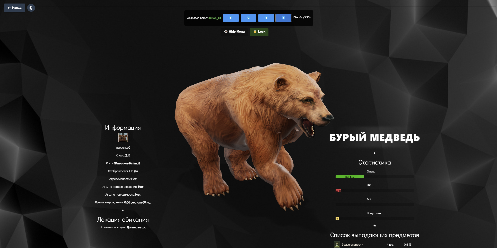
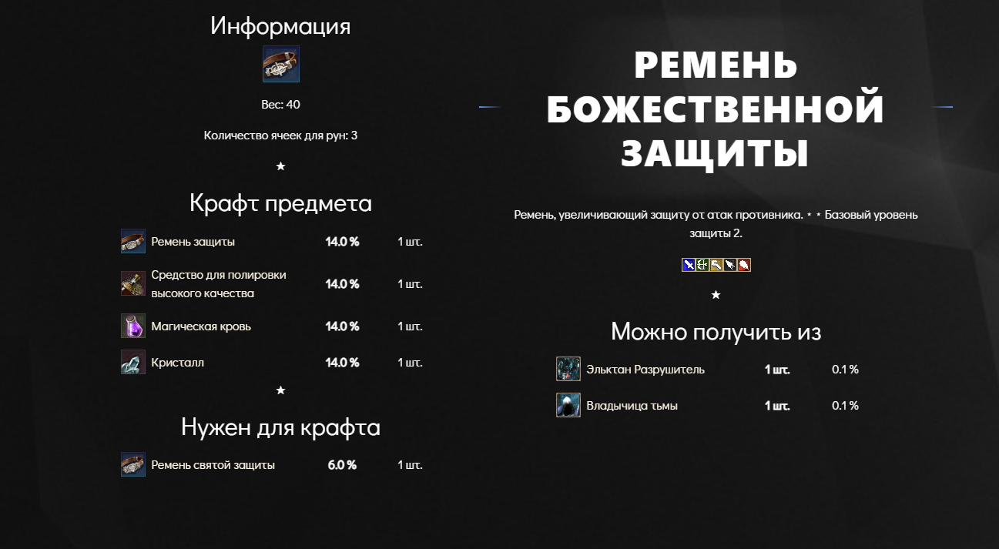

# R2-HTML-DB
Created by [Victor Pavlov](https://vk.com/akselrus) | [R2Genius](https://vk.com/r2genius)

## Светлая и темная темы:
Dark Mode:

## Скролл-меню:

## Страница поиска по монстрам или предметам:

## Страница доспехов:

## Страница оружия:

## Страница монстров / NPC:

## Страница крафта свитками:

## Страница обычного крафта:

## Etc:

