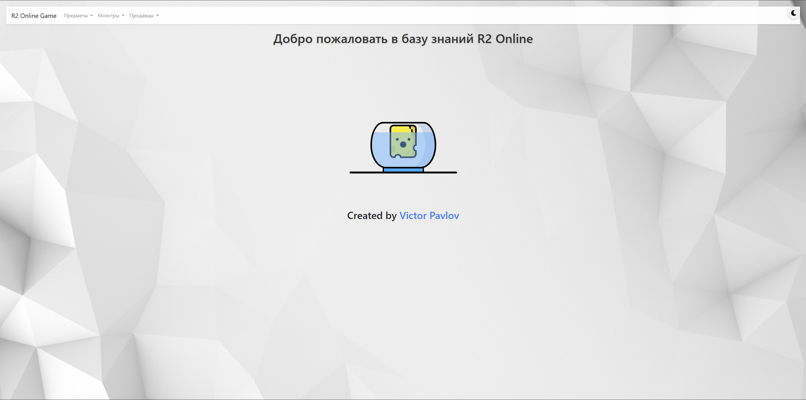
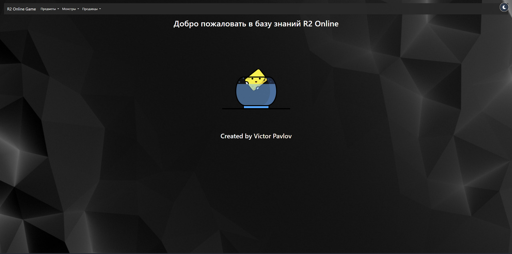
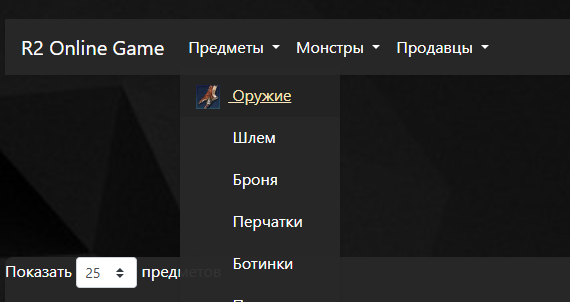
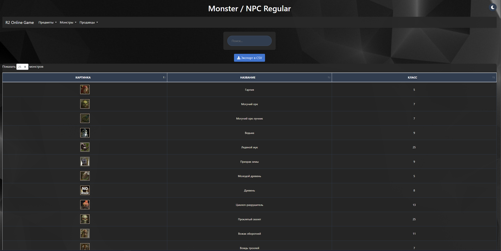
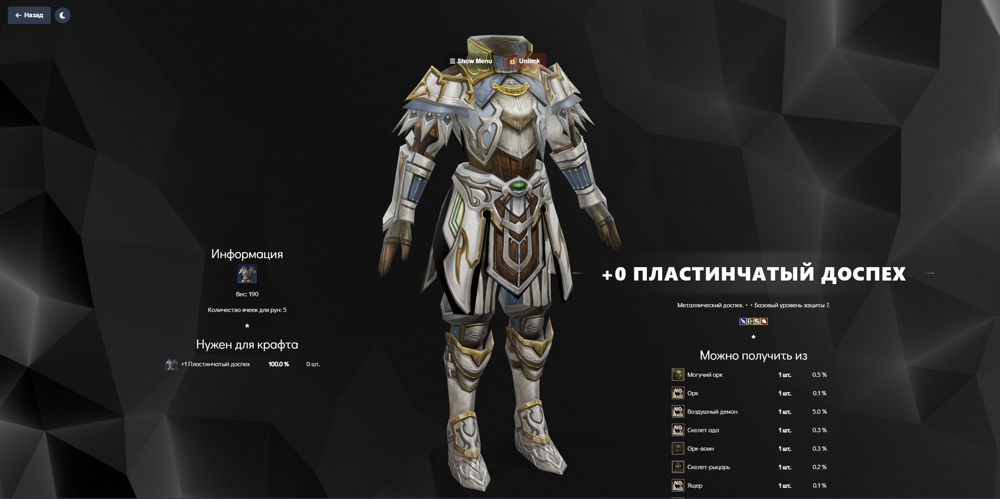
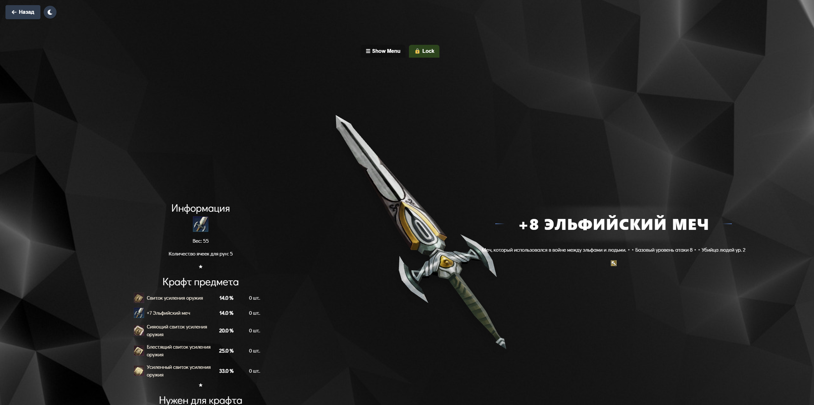
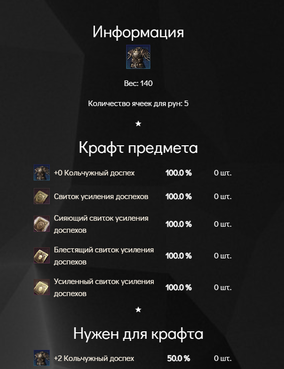
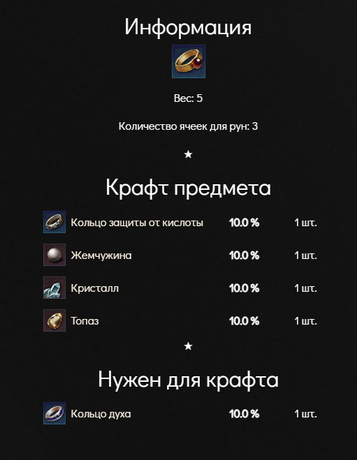

# R2-HTML-DB 🎮

**Созданно [Victor Pavlov](https://vk.com/akselrus) | [R2Genius](https://vk.com/r2genius)**

*Современная вики для R2 Online по собственной базе данных с удобным интерфейсом и расширенным функционалом*

## 🌟 Основные функции

### 🎨 Адаптивный дизайн
Поддержка светлой и темной темы для комфортного использования:

Скриншоты тем

#### Светлая тема

#### Темная тема

### 📱 Удобная навигация
Интуитивное скролл-меню для быстрого доступа к нужным разделам:

### 🔍 Расширенный поиск
Мощная система поиска по собственной базе данных монстров, предметов, продавцов и прочего:

## 💎 Основные разделы

### ⚔️ Экипировка
- **Доспехи**
  
- **Оружие**
  

### 👾 Бестиарий
Подробная информация о монстрах и NPC с анимированными моделями:

### 🛠️ Системы крафта
- **Крафт свитками**
  
- **Обычный крафт**
  

### 📦 Прочие предметы

## 🤝 Вклад в проект

Если вы хотите внести свой вклад в развитие проекта:
1. Создайте форк репозитория
2. Создайте ветку для своих изменений
3. Внесите необходимые изменения
4. Создайте Pull Request

Made with ❤️ for R2 Online community

